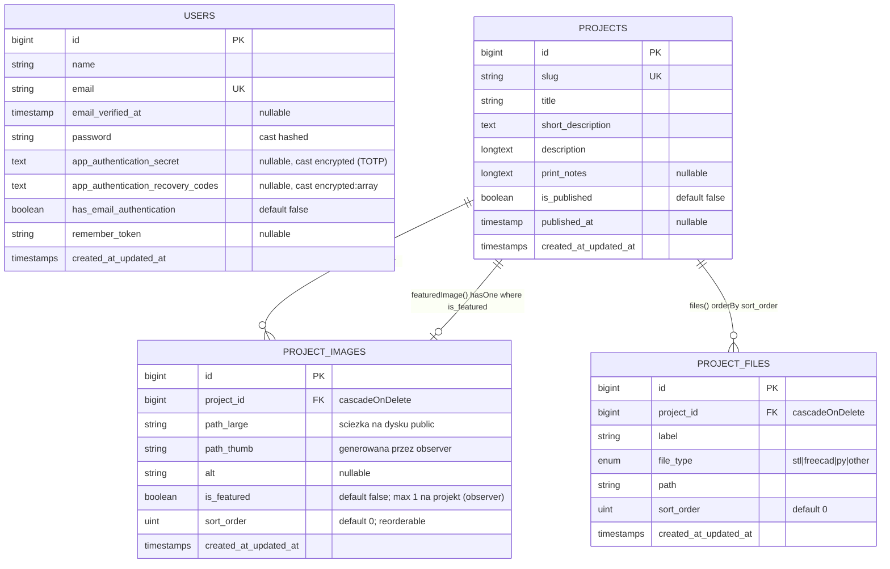

# 03 — Model domeny i baza danych

## 1. ERD



Tabele systemowe Laravel: `password_reset_tokens`, `sessions` (migracja users), `cache`,
`cache_locks`, `jobs`, `job_batches`, `failed_jobs` (standardowe migracje `0001_01_01_*`).
Brak tabel dla kategorii, tagów, ustawień.

## 2. Migracje (kolejność wykonania)

| Plik | Co robi | Uwagi |
|---|---|---|
| `0001_01_01_000000_create_users_table` | `users`, `password_reset_tokens`, `sessions` | standard Laravel |
| `0001_01_01_000001_create_cache_table` | `cache`, `cache_locks` | `CACHE_STORE=database` |
| `0001_01_01_000002_create_jobs_table` | `jobs`, `job_batches`, `failed_jobs` | kolejka `database` |
| `2026_08_29_213304_create_projects_table` | `projects` | `slug` unique |
| `2026_08_29_213305_create_project_images_table` | `project_images` | już zawiera `is_featured` (dopisane później do pliku create) |
| `2026_08_29_213306_create_project_files_table` | `project_files` | `enum('file_type', [...])` |
| `2026_08_30_225700_add_is_featured_to_project_images_table` | ALTER dodający `is_featured` **tylko jeśli nie istnieje** (`Schema::hasColumn`) | historyczny duplikat; guard konieczny dla sqlite w testach. **W klonie nie kopiować** — dać kolumnę od razu w create |
| `2026_08_31_202500_add_two_factor_columns_to_users_table` | `app_authentication_secret` (text), `app_authentication_recovery_codes` (text), `has_email_authentication` (bool) po `password` | kolumny wymagane przez kontrakty MFA Filamenta; `text`, bo wartości szyfrowane są długie |

Pełny kod migracji: `10-kod-zrodlowy.md` §database.

Uwagi projektowe:

- Klucze obce `foreignId('project_id')->constrained()->cascadeOnDelete()` — usunięcie projektu
  kasuje rekordy obrazów/plików **na poziomie DB**, więc **observery `deleting` się nie odpalą** i
  pliki na dysku zostaną osierocone. Jeśli to ważne, w `Project` dodaj `deleting` → iteracja
  `$project->images->each->delete()` (patrz `05-media-pipeline.md` §5).
- `longText` na opisy — gotowe pod HTML z WYSIWYG.
- `published_at` niezależne od `is_published` (lista sortuje po `published_at`, filtr po
  `is_published`); w panelu pole `published_at` widoczne tylko gdy toggle włączony, ale **nie jest
  wypełniane automatycznie** — może być `null` przy opublikowanym projekcie (sortowanie `latest()`
  wstawi NULL‑e na koniec w MySQL). W klonie: ustawiaj `published_at ??= now()` w mutatorze/observerze.

## 3. Modele Eloquent

### 3.1 `App\Models\Project`

```php
protected $fillable = ['slug','title','short_description','description','print_notes','is_published','published_at'];
protected $casts = ['is_published' => 'boolean', 'published_at' => 'datetime'];
public function images(): HasMany   { return $this->hasMany(ProjectImage::class)->orderBy('sort_order'); }
public function files(): HasMany    { return $this->hasMany(ProjectFile::class)->orderBy('sort_order'); }
public function featuredImage(): HasOne { return $this->hasOne(ProjectImage::class)->where('is_featured', true); }
```

- Route model binding po slug: `Route::get('/projekty/{project:slug}', ...)` — Laravel wykonuje
  `Project::where('slug', $value)->firstOrFail()`; kontroler dodatkowo `abort_unless($project->is_published, 404)`.
- Brak `getRouteKeyName()` w modelu — nie jest potrzebny: przy `{project:slug}` w definicji trasy
  `route('projects.show', $project)` generuje URL z pola `slug` (Laravel ≥ 7 respektuje „binding
  field" z trasy także przy generowaniu URL). Wynik: `/projekty/sample-bracket`. Gdybyś chciał
  używać slug **wszędzie** (także `{project}` bez `:slug`), dodaj `getRouteKeyName(): string { return 'slug'; }`.
- Brak scope'a `published()` — filtr powtarzany w kontrolerze. W klonie dodaj
  `scopePublished(Builder $q)`.

### 3.2 `App\Models\ProjectImage`

```php
protected $fillable = ['project_id','path_large','path_thumb','alt','is_featured','sort_order'];
protected $casts = ['is_featured' => 'boolean'];
public function setPathLargeAttribute(mixed $value): void   // mutator
{
    if ($value instanceof UploadedFile) {                  // ścieżka programistyczna (nie Filament)
        $paths = ProjectMedia::storeImage($value);
        $this->attributes['path_large'] = $paths['path_large'];
        $this->attributes['path_thumb'] = $paths['path_thumb'];
        return;
    }
    $this->attributes['path_large'] = $value;              // Filament podaje string
}
public function project(): BelongsTo
```

- Observer `ProjectImageObserver` (creating/updating/deleting) — pełna logika w `05-media-pipeline.md`.
- `sort_order` zarządza tabela Filamenta `->reorderable('sort_order')` (drag & drop) oraz pole w formularzu.

### 3.3 `App\Models\ProjectFile`

```php
protected $fillable = ['project_id','label','file_type','path','sort_order'];
public function project(): BelongsTo
```

- Observer `ProjectFileObserver`: `creating` (konwersja `UploadedFile` → string, martwa gałąź) i
  `deleting` (usuwa plik z dysku `public`).
- Brak castu/enum PHP dla `file_type` — wartości pilnuje `Select` w panelu + `enum` w MySQL.

### 3.4 `App\Models\User`

```php
#[Fillable(['name','email','password'])]
#[Hidden(['password','remember_token','app_authentication_secret','app_authentication_recovery_codes'])]
class User extends Authenticatable implements FilamentUser, HasAppAuthentication, HasAppAuthenticationRecovery, HasEmailAuthentication
{
    use HasFactory, Notifiable;
    public function canAccessPanel(Panel $panel): bool { return true; }   // każdy user = admin
    protected function casts(): array { return [
        'email_verified_at' => 'datetime', 'password' => 'hashed',
        'app_authentication_secret' => 'encrypted',
        'app_authentication_recovery_codes' => 'encrypted:array',
        'has_email_authentication' => 'boolean',
    ]; }
    // gettery/settery kontraktów MFA: getAppAuthenticationSecret/saveAppAuthenticationSecret,
    // getAppAuthenticationHolderName (=> email), getAppAuthenticationRecoveryCodes/save...,
    // hasEmailAuthentication/toggleEmailAuthentication — każdy setter robi $this->save()
}
```

- Atrybuty PHP `#[Fillable]`/`#[Hidden]` — nowość Laravel 12+/13 zamiast właściwości `$fillable`.
- `password` cast `hashed` → w seederze/tinkerze podajesz plaintext.

## 4. Seeder — `database/seeders/DatabaseSeeder.php`

```php
use WithoutModelEvents;   // observery NIE działają podczas seedowania
User::updateOrCreate(['email' => 'admin@3dprint.local'], ['name' => 'Admin', 'password' => 'password']);
User::updateOrCreate(['email' => 'test@example.com'],    ['name' => 'Test User', 'password' => 'password']);
Project::updateOrCreate(['slug' => 'sample-bracket'], [
    'title' => 'Sample Bracket',
    'short_description' => 'A simple bracket for testing the project layout and gallery.',
    'description' => 'This sample project demonstrates the MVP project page, gallery, and download area.',
    'print_notes' => 'PLA, 0.2 mm layer height, 20% infill.',
    'is_published' => true, 'published_at' => now(),
]);
```

- Idempotentny: wielokrotne `db:seed` nie duplikuje, ale **nadpisuje** hasła i pola projektu.
- Nie tworzy obrazów/plików (brak fizycznych plików w repo) — po świeżym seedzie lista pokazuje
  projekt bez miniatury, karta bez galerii.
- Brak fabryk dla `Project*` — testy domenowe musiałyby je dodać (`php artisan make:factory ProjectFactory`).
- Produkcja: `db:seed` resetuje hasło admina → owinąć w `if (app()->environment('local'))` lub
  wydzielić `DevSeeder`.

## 5. Zapytania w aplikacji (wzorce)

| Miejsce | Zapytanie | Uwagi |
|---|---|---|
| `ProjectController::index` | `Project::where('is_published', true)->with(['featuredImage','images'])->latest('published_at')->get()` | eager loading obu relacji, bo widok robi fallback `images->first()`; brak paginacji |
| `ProjectController::show` | binding po slug → `abort_unless(is_published, 404)` → `load(['images','files'])` | |
| `ProjectImageObserver` | `ProjectImage::where('project_id', X)->whereKeyNot(id)->update(['is_featured' => false])` | masowy `update()` — omija observery i timestamps innych rekordów (celowo) |
| Filament `ProjectResource::table` | `defaultSort('created_at','desc')`, kolumny searchable/sortable | |
| Filament RM | `reorderable('sort_order')` → Filament aktualizuje `sort_order` masowo | |

## 6. Nazewnictwo i konwencje bazy

- Tabele snake_case plural, klucz `id` bigint, FK `project_id`, timestamps wszędzie.
- Ścieżki mediów przechowywane **względem roota dysku `public`** (np.
  `projects/images/01J8....jpg`), bez `/storage/` i bez domeny → gotowe pod S3 (zmiana dysku, nie danych).
- Slug ręczny w panelu (`TextInput::make('slug')->unique(ignoreRecord: true)`) — brak
  autogenerowania z tytułu (w klonie: `TextInput::make('title')->live(onBlur: true)->afterStateUpdated(fn ($state, Set $set) => $set('slug', Str::slug($state)))`).
