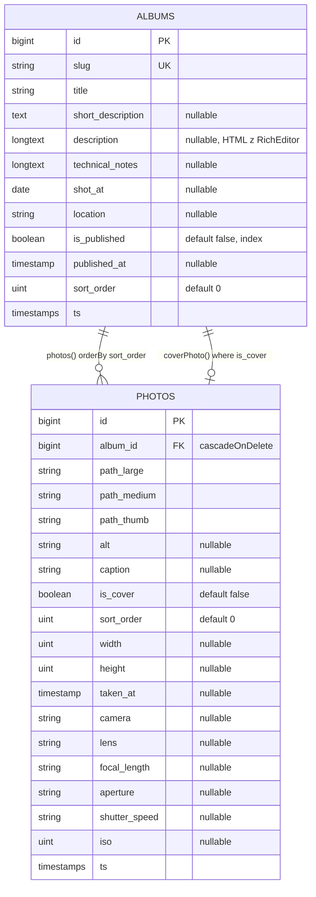

# 08 — Blueprint: portfolio fotograficzne na bazie architektury `3dprint`

> Cel: zbudować **nową aplikację** (osobne repo) o identycznej architekturze — Laravel 13 +
> Filament 5 + MySQL 8.4 + Docker + Vite/Tailwind 4 + GLightbox — ale dla domeny *fotografia*:
> albumy (serie/galerie) zdjęć zamiast projektów druku 3D. Poniżej: co przenieść 1:1, co zmienić,
> jaki schemat, jaki pipeline obrazów, plan etapów, checklisty i pytania, które trzeba rozstrzygnąć
> z właścicielem projektu **przed** kodowaniem.

## 1. Mapowanie domeny 3dprint → foto

| 3dprint | Portfolio foto | Komentarz |
|---|---|---|
| `Project` / `projects` | **`Album`** / `albums` | seria/galeria zdjęć (alternatywy nazw: `Gallery`, `Series`, `Collection`) |
| `ProjectImage` / `project_images` | **`Photo`** / `photos` | zdjęcie w albumie |
| `ProjectFile` / `project_files` | *(usuń w MVP)* lub `AlbumDownload` | portfolio foto rzadko oferuje pliki; wzorzec zachowany w `10-kod-zrodlowy.md` gdyby był potrzebny (np. PDF portfolio, cennik) |
| `title`, `slug`, `short_description`, `description` | to samo | `description` jako HTML z `RichEditor` |
| `print_notes` | `technical_notes` (nullable) | „sprzęt i technika" — opcjonalnie; albo usuń |
| `is_published`, `published_at` | to samo | + auto‑ustawianie `published_at` |
| — | `sort_order` na `albums` | ręczna kolejność albumów na liście (portfolio = kuracja, nie chronologia) |
| — | `shot_at` (date), `location` (string) | metadane serii |
| `path_large`, `path_thumb` | `path_large`, `path_medium`, `path_thumb` | 3 rozmiary (lightbox / grid / kafelek) |
| `alt` | `alt` + `caption` | alt (a11y) i podpis (widoczny w lightboxie) |
| `is_featured` | `is_cover` | okładka albumu |
| — | `width`, `height` | znane proporcje → brak „skoków" layoutu (masonry) |
| — | EXIF: `taken_at`, `camera`, `lens`, `focal_length`, `aperture`, `shutter_speed`, `iso` | odczyt przy uploadzie (`exif_read_data`), wyświetlanie opcjonalne |
| `featuredImage()` | `coverPhoto()` | `hasOne(Photo::class)->where('is_cover', true)` |
| `ImagesRelationManager` | `PhotosRelationManager` | + bulk upload, + `ImageColumn`, + `ToggleColumn is_cover` |
| `FilesRelationManager` | — | |
| `ProjectMedia` | `PhotoMedia` | z realnym resize/WebP |
| `ProjectImageObserver` | `PhotoObserver` | + zapis wymiarów/EXIF |
| `/projekty`, `/projekty/{slug}` | `/galerie`, `/galerie/{slug}` (PL) **lub** `/galleries/...` (EN) | **decyzja** (pytanie §10) |
| `projects.index/show` | `albums.index/show` | |
| `resources/views/projects/*` | `resources/views/albums/*` | |
| `HomeController` | `HomeController` (+ wyróżnione albumy) | hero = losowe/wybrane zdjęcie |
| `3dprint-*` (kontenery), `3dprint-net`, DB `3dprint` | np. `photo-*`, `photo-net`, DB `photo` | uniknąć konfliktu z działającym 3dprint |
| `Color::Amber` | dowolny (np. `Color::Zinc`/`Slate` — neutralny dla foto) | |

Opcjonalne rozszerzenia (etap 2+): `categories` (N‑M z albums: portret/krajobraz/reportaż),
`tags`, `settings` (hero, bio, dane kontaktowe, social), `pages` (O mnie), formularz kontaktowy
(mail przez SMTP — infrastruktura Mailpit już jest), wielojęzyczność.

## 2. Schemat bazy (propozycja)



```php
// database/migrations/xxxx_create_albums_table.php
Schema::create('albums', function (Blueprint $t) {
    $t->id();
    $t->string('slug')->unique();
    $t->string('title');
    $t->text('short_description')->nullable();
    $t->longText('description')->nullable();
    $t->longText('technical_notes')->nullable();
    $t->date('shot_at')->nullable();
    $t->string('location')->nullable();
    $t->boolean('is_published')->default(false)->index();
    $t->timestamp('published_at')->nullable();
    $t->unsignedInteger('sort_order')->default(0);
    $t->timestamps();
});
// xxxx_create_photos_table.php
Schema::create('photos', function (Blueprint $t) {
    $t->id();
    $t->foreignId('album_id')->constrained()->cascadeOnDelete();
    $t->string('path_large');
    $t->string('path_medium');
    $t->string('path_thumb');
    $t->string('alt')->nullable();
    $t->string('caption')->nullable();
    $t->boolean('is_cover')->default(false);
    $t->unsignedInteger('sort_order')->default(0);
    $t->unsignedInteger('width')->nullable();
    $t->unsignedInteger('height')->nullable();
    $t->timestamp('taken_at')->nullable();
    $t->string('camera')->nullable();
    $t->string('lens')->nullable();
    $t->string('focal_length', 32)->nullable();
    $t->string('aperture', 32)->nullable();
    $t->string('shutter_speed', 32)->nullable();
    $t->unsignedInteger('iso')->nullable();
    $t->timestamps();
    $t->index(['album_id', 'sort_order']);
});
```

Zasady przeniesione z 3dprint: `users` + kolumny 2FA w **jednej** migracji create (nie ALTER),
`is_cover` od razu w create (bez duplikatu jak `is_featured`), brak `enum` MySQL.

## 3. Modele

```php
class Album extends Model
{
    protected $fillable = ['slug','title','short_description','description','technical_notes','shot_at','location','is_published','published_at','sort_order'];
    protected $casts = ['is_published' => 'boolean', 'published_at' => 'datetime', 'shot_at' => 'date'];

    protected static function booted(): void
    {
        static::saving(function (Album $a) {
            $a->slug = $a->slug ?: Str::slug($a->title);
            if ($a->is_published && ! $a->published_at) $a->published_at = now();
        });
        static::deleting(fn (Album $a) => $a->photos->each->delete());   // observery Photo -> pliki z dysku
    }

    public function scopePublished(Builder $q): Builder { return $q->where('is_published', true); }
    public function photos(): HasMany { return $this->hasMany(Photo::class)->orderBy('sort_order'); }
    public function coverPhoto(): HasOne { return $this->hasOne(Photo::class)->where('is_cover', true); }
    public function coverOrFirst(): ?Photo { return $this->coverPhoto ?? $this->photos->first(); }  // wymaga eager load obu
}

class Photo extends Model
{
    protected $fillable = ['album_id','path_large','path_medium','path_thumb','alt','caption','is_cover','sort_order','width','height','taken_at','camera','lens','focal_length','aperture','shutter_speed','iso'];
    protected $casts = ['is_cover' => 'boolean', 'taken_at' => 'datetime'];
    public function album(): BelongsTo { return $this->belongsTo(Album::class); }
    public function url(string $size = 'large'): string { return Storage::disk(config('media.disk', 'public'))->url($this->{"path_$size"}); }
    public function aspectRatio(): ?float { return $this->width && $this->height ? $this->width / $this->height : null; }
}
```

`User` — **skopiuj 1:1** z 3dprint (`10-kod-zrodlowy.md`), zmień tylko nic. Kolumny 2FA dodaj do
migracji `create_users_table`.

## 4. Pipeline obrazów dla fotografii (najważniejsza różnica)

### 4.1 Wymagania

| Rozmiar | Zastosowanie | Parametry |
|---|---|---|
| `thumb` | kafelki albumów, siatka w albumie (opcja kwadratowa) | `cover(600, 600)` WebP q80 (600 dla ekranów retina; wyświetlane 300 px) |
| `medium` | siatka masonry w albumie, lightbox mobile | `scaleDown(width: 1600)` (dłuższy bok ≤ 1600) WebP q82 |
| `large` | lightbox desktop | `scaleDown(2560, 2560)` WebP q85 (**decyzja**: 2048 vs 2560 vs pełny) |
| oryginał | — | **decyzja**: nie przechowywać (jak 3dprint) *albo* dysk prywatny `local` z możliwością pobrania przez admina |

Dodatkowo: auto‑orientacja EXIF, strip metadanych z wersji publicznych (prywatność GPS!),
odczyt EXIF do DB **przed** stripem, opcjonalny watermark (tekst/PNG w rogu large/medium),
zapis `width/height` **wersji large**.

### 4.2 Infrastruktura (zmiany względem 3dprint)

```dockerfile
# docker/php/Dockerfile — dodać libwebp-dev i --with-webp (GD) …
    libwebp-dev \
 && docker-php-ext-configure gd --with-freetype --with-jpeg --with-webp \
# …albo Imagick (lepszy resample Lanczos, ICC, HEIC przy libheif):
    libmagickwand-dev \
 && pecl install imagick && docker-php-ext-enable imagick
# ini:
    echo 'upload_max_filesize=64M'; echo 'post_max_size=64M'; echo 'memory_limit=512M'; echo 'max_execution_time=300';
```
```nginx
client_max_body_size 64m;
fastcgi_read_timeout 300;
```
```bash
composer require intervention/image          # v3
php artisan livewire:publish --config          # temporary_file_upload.rules => ['required','file','max:65536']
```

### 4.3 Kod — `App\Support\PhotoMedia`

```php
final class PhotoMedia
{
    public const DIR = 'albums/photos';

    public static function process(string $sourcePath, string $disk = 'public'): array
    {
        $storage = Storage::disk($disk);
        $absolute = $storage->path($sourcePath);                 // local/public disk only
        $exif = self::readExif($absolute);                        // przed re-encode (strip)
        $manager = new ImageManager(new \Intervention\Image\Drivers\Gd\Driver()); // lub Imagick\Driver
        $base = self::DIR . '/' . Str::ulid();

        $large = $manager->read($absolute)->orient()->scaleDown(2560, 2560);
        $storage->put("$base-large.webp", (string) $large->toWebp(85));
        $medium = $manager->read($absolute)->orient()->scaleDown(width: 1600);
        $storage->put("$base-medium.webp", (string) $medium->toWebp(82));
        $thumb = $manager->read($absolute)->orient()->cover(600, 600);
        $storage->put("$base-thumb.webp", (string) $thumb->toWebp(80));

        $storage->delete($sourcePath);                            // brak oryginału (patrz decyzja)

        return [
            'path_large' => "$base-large.webp", 'path_medium' => "$base-medium.webp", 'path_thumb' => "$base-thumb.webp",
            'width' => $large->width(), 'height' => $large->height(),
        ] + $exif;
    }

    public static function readExif(string $absolute): array
    {
        $e = @exif_read_data($absolute, 'EXIF', true) ?: [];
        $ifd0 = $e['IFD0'] ?? []; $ex = $e['EXIF'] ?? [];
        $frac = fn (?string $v) => $v && str_contains($v, '/') ? (fn ($a, $b) => $b ? $a / $b : null)(...array_map('floatval', explode('/', $v))) : null;
        return [
            'camera'        => trim(($ifd0['Make'] ?? '') . ' ' . ($ifd0['Model'] ?? '')) ?: null,
            'lens'          => $ex['UndefinedTag:0xA434'] ?? $ex['LensModel'] ?? null,
            'focal_length'  => ($f = $frac($ex['FocalLength'] ?? null)) ? round($f) . ' mm' : null,
            'aperture'      => ($a = $frac($ex['FNumber'] ?? null)) ? 'f/' . rtrim(rtrim(number_format($a, 1), '0'), '.') : null,
            'shutter_speed' => $ex['ExposureTime'] ?? null,        // np. "1/250"
            'iso'           => isset($ex['ISOSpeedRatings']) ? (int) (is_array($ex['ISOSpeedRatings']) ? $ex['ISOSpeedRatings'][0] : $ex['ISOSpeedRatings']) : null,
            'taken_at'      => isset($ex['DateTimeOriginal']) ? Carbon::createFromFormat('Y:m:d H:i:s', $ex['DateTimeOriginal']) : null,
        ];
    }

    public static function delete(Photo $photo, string $disk = 'public'): void
    {
        Storage::disk($disk)->delete(array_filter([$photo->path_large, $photo->path_medium, $photo->path_thumb]));
    }
}
```

### 4.4 Observer — `PhotoObserver`

```php
public function creating(Photo $photo): void
{
    if (is_string($photo->path_large) && blank($photo->path_thumb)) {       // Filament podał ścieżkę surowego uploadu
        $photo->fill(PhotoMedia::process($photo->path_large));             // nadpisuje path_large (.webp), medium, thumb, wymiary, EXIF
    }
    $this->ensureSingleCover($photo);
}
public function updating(Photo $photo): void
{
    if ($photo->isDirty('path_large') && is_string($photo->path_large)) {
        Storage::disk('public')->delete(array_filter([$photo->getOriginal('path_large'), $photo->getOriginal('path_medium'), $photo->getOriginal('path_thumb')]));
        $photo->fill(PhotoMedia::process($photo->path_large));
    }
    $this->ensureSingleCover($photo);
}
public function deleting(Photo $photo): void { PhotoMedia::delete($photo); }

private function ensureSingleCover(Photo $photo): void
{
    if ($photo->is_cover) Photo::where('album_id', $photo->album_id)->whereKeyNot($photo->getKey() ?? 0)->update(['is_cover' => false]);
}
```

Uwaga na pułapkę z 3dprint: w `creating` `path_thumb` jest `NOT NULL` — observer **musi** je
ustawić przed INSERT (tak jest powyżej). Rejestracja w `AppServiceProvider::boot()`.

### 4.5 Sync vs kolejka

| Wariant | Kiedy | Jak |
|---|---|---|
| **Sync (MVP)** | ≤ ~10 zdjęć na jeden submit; `max_execution_time=300` | przetwarzanie w observerze (jak wyżej); prosto, bez workera |
| **Kolejka (etap 2)** | bulk 50+ zdjęć, hosting z limitem czasu | rekord tworzony z `status=processing` i ścieżką surowego uploadu; `ProcessPhoto` job → `PhotoMedia::process` → update; usługa `queue` w compose: `command: php artisan queue:work --sleep=3 --tries=3`; `QUEUE_CONNECTION=database` (wtedy maile Filamenta też przez workera — spójnie) |

Na hostingu współdzielonym bez procesów w tle → zostań przy sync albo cron `queue:work --stop-when-empty` co minutę.

## 5. Panel admina

### 5.1 `AlbumResource` (kopia `ProjectResource` + zmiany)

```php
Section::make('Album')->schema([
    TextInput::make('title')->required()->maxLength(255)->live(onBlur: true)
        ->afterStateUpdated(fn (string $operation, $state, Set $set) => $operation === 'create' ? $set('slug', Str::slug($state)) : null),
    TextInput::make('slug')->required()->maxLength(255)->unique(ignoreRecord: true)->alphaDash(),
    Textarea::make('short_description')->rows(3)->maxLength(500),
    DatePicker::make('shot_at'),
    TextInput::make('location')->maxLength(255),
    Toggle::make('is_published')->live(),
    DateTimePicker::make('published_at')->visible(fn (Get $get) => (bool) $get('is_published')),
    TextInput::make('sort_order')->numeric()->default(0),
])->columns(2),
Section::make('Description')->schema([RichEditor::make('description')->fileAttachmentsDisk('public')->fileAttachmentsDirectory('albums/inline')])->columnSpanFull(),
Section::make('Technical notes')->schema([RichEditor::make('technical_notes')])->columnSpanFull(),
```

Tabela: `ImageColumn::make('coverPhoto.path_thumb')->disk('public')->square()`, `title`, `slug`,
`IconColumn is_published`, `published_at`, `photos_count` (`->counts('photos')`), `reorderable('sort_order')`,
filtr `TernaryFilter::make('is_published')`, `recordActions([EditAction, DeleteAction])`,
`toolbarActions([DeleteBulkAction])`.

### 5.2 `PhotosRelationManager` (kopia `ImagesRelationManager` + rozszerzenia)

Formularz pojedynczego zdjęcia: **identyczny wzorzec** (Placeholder z podglądem, `FileUpload::make('path_large')->image()->disk('public')->directory(PhotoMedia::DIR)->formatStateUsing(fn () => [])->dehydrated(fn ($s) => filled($s))->maxSize(65536)`),
+ `TextInput caption`, `TextInput alt`, `Toggle is_cover`, `TextInput sort_order`, sekcja
`Placeholder` z EXIF (read‑only).

Tabela:
```php
->columns([
    ImageColumn::make('path_thumb')->disk('public')->square()->size(64),
    TextColumn::make('caption')->limit(40),
    ToggleColumn::make('is_cover'),        // szybkie ustawienie okładki (observer pilnuje unikalności)
    TextColumn::make('camera')->toggleable(isToggledHiddenByDefault: true),
    TextColumn::make('sort_order')->sortable(),
])->defaultSort('sort_order')->reorderable('sort_order')
->headerActions([
    CreateAction::make()->label('Add photo'),
    Action::make('bulkUpload')->label('Upload many')->icon('heroicon-o-arrow-up-tray')
        ->schema([FileUpload::make('photos')->multiple()->image()->reorderable()->maxFiles(50)->maxSize(65536)
            ->disk('public')->directory(PhotoMedia::DIR)->required()])
        ->action(function (array $data, RelationManager $livewire): void {
            $album = $livewire->getOwnerRecord();
            $next = (int) $album->photos()->max('sort_order') + 1;
            foreach ($data['photos'] as $i => $path) {                 // multiple => tablica stringów ścieżek
                $album->photos()->create(['path_large' => $path, 'sort_order' => $next + $i]);   // observer robi resztę
            }
        }),
])
->recordActions([EditAction::make(), DeleteAction::make()])
->toolbarActions([DeleteBulkAction::make()]);
```

> W Filament 5 formularz akcji definiuje się przez `->schema([...])` (alias `->form()` nadal działa).
> `FileUpload::multiple()` dehydratuje **tablicę ścieżek** (stringów) — pętla `create()` per ścieżka.

### 5.3 Panel — reszta

`AdminPanelProvider` **1:1** z 3dprint (login, passwordReset, profile, MFA; zmień `colors`,
usuń `FilamentInfoWidget`). Rozważ `->multiFactorAuthentication([...], isRequired: true)` na prod.
Opcjonalnie widget statystyk (liczba albumów/zdjęć) i `->brandName('…')`, `->favicon()`.

## 6. Frontend publiczny

| Strona | Trasa | Treść |
|---|---|---|
| Home | `/` | hero (zdjęcie okładkowe wybranego albumu lub losowe), krótkie bio, 3–6 wyróżnionych albumów |
| Galerie | `/galerie` | siatka kafelków 1:1 (`thumb`), tytuł, `shot_at`/`location`; sort `sort_order`, potem `published_at desc`; paginacja 24 |
| Album | `/galerie/{slug}` | tytuł, opis (HTML), **masonry** (`columns-1 sm:columns-2 lg:columns-3 gap-4`, `` z `medium`), lightbox GLightbox z `large` + `data-description` (caption + EXIF), technical notes |
| O mnie / Kontakt | `/o-mnie`, `/kontakt` | statyczne Blade (etap 1) → z `settings` (etap 2) |

Layout: skopiuj `layouts/app.blade.php`, popraw aktywny link na `routeIs()`, dodaj `@stack('meta')`,
OG image = cover large, stopka, mobile nav (Alpine.js jest już w bundlu Livewire tylko w panelu —
na froncie użyj `<details>` lub małego vanilla JS). Rozważ ciemny motyw (typowy dla foto):
`class="bg-neutral-950 text-neutral-100"`.

GLightbox: `GLightbox({ selector: '[data-glightbox]', loop: true, touchNavigation: true, zoomable: false, preload: true })`.
Dla `srcset`: ``.

`@tailwindcss/typography` dla `.prose` (opisy HTML). Zbuduj `npm run build` przed testami
(`withoutVite()` w `TestCase`).

## 7. Co skopiować 1:1, co zaadaptować, czego nie kopiować

| Skopiuj bez zmian (z `10-kod-zrodlowy.md`) | Zaadaptuj (zmiana nazw + rozszerzenia) | Nie kopiuj |
|---|---|---|
| `docker-compose.yml` (zmień nazwy/porty) | `Dockerfile` (+webp/imagick, +ini limity) | migracja `add_is_featured…` (duplikat) |
| `docker/nginx/default.conf` (+`client_max_body_size`) | `ProjectResource` → `AlbumResource` | `FilesRelationManager`, `ProjectFile`, `ProjectFileObserver` (chyba że downloads) |
| `scripts/db.sh`, `zip-project.sh`, `deploy-package.sh` (nazwy archiwów) | `ImagesRelationManager` → `PhotosRelationManager` | `ProjectMedia::storeImage` (mylące `.webp` bez konwersji) |
| `app/Models/User.php` + migracja 2FA (scal z create_users) | `ProjectImageObserver` → `PhotoObserver` | `mutateFormDataBeforeCreate` (martwy kod) |
| `AdminPanelProvider.php` | `ProjectMedia` → `PhotoMedia` (realny resize) | `HomeController` import `Project` |
| `AppServiceProvider.php` (rejestracja observerów) | `ProjectController` → `AlbumController` (+scope, +paginate) | `test@example.com` z seedera |
| `tests/Feature/AdminAuthTest.php` | widoki Blade (nazwy, masonry, meta) | |
| `phpunit.xml`, `vite.config.js`, `package.json` (+typography) | `resources/css/app.css` (+`@plugin`), `glightbox.js` (opcje) | |
| `resources/views/filament/project-image-preview.blade.php` → `photo-preview` | `DatabaseSeeder` (idempotentny, `if local`) | |
| `AGENTS.md`/`CLAUDE.md` jako szablon (zaktualizuj domenę) | `.env.docker.example` (kompletny) | |
| konwencje: `commands-log.md`, `plan.md` | | |

## 8. Plan realizacji (etapy — analogicznie do `plan.md` §11)

```bash
# Etap 0 — decyzje (§10) zapisane w plan.md nowego repo

# Etap 1 — szkielet + Docker
mkdir photo && cd photo && git init
# skopiuj docker/, docker-compose.yml (zmień nazwy: photo-app/web/db/mailpit, photo-net, DB photo, porty 8081/3307/8026), scripts/, *.sh, .editorconfig, .gitignore
docker compose up -d --build
docker compose exec app sh -lc 'composer create-project laravel/laravel /tmp/l && cp -a /tmp/l/. /var/www/html/ && rm -rf /tmp/l'
cp .env.docker.example .env && docker compose exec app php artisan key:generate
echo "127.0.0.1 photo.local" | sudo tee -a /etc/hosts
docker compose exec app composer require filament/filament -W intervention/image
docker compose exec app php artisan filament:install --panels
nvm use 20 && npm install && npm i glightbox && npm i -D @tailwindcss/typography && npm run build

# Etap 2 — baza + modele + auth
docker compose exec -u www-data app php artisan make:model Album -m
docker compose exec -u www-data app php artisan make:model Photo -m
#   uzupełnij migracje wg §2 (users: dodaj kolumny 2FA do create_users_table), modele wg §3, User 1:1 z 3dprint
docker compose exec -u www-data app php artisan make:observer PhotoObserver --model=Photo
#   PhotoMedia wg §4.3, rejestracja w AppServiceProvider, AdminPanelProvider 1:1
docker compose exec -u www-data app php artisan migrate --seed
docker compose exec -u www-data app php artisan storage:link

# Etap 3 — panel
docker compose exec -u www-data app php artisan make:filament-resource Album --generate
docker compose exec -u www-data app php artisan make:filament-relation-manager AlbumResource photos caption
#   dostosuj wg §5; test ręczny: create album -> upload many -> reorder -> cover -> replace -> delete (sprawdź storage/app/public/albums/photos)

# Etap 4 — front
docker compose exec -u www-data app php artisan make:controller AlbumController
#   trasy, layout, widoki wg §6; npm run build

# Etap 5 — testy
#   AdminAuthTest 1:1; AlbumPublicTest (200/404, sort, cover fallback); PhotoObserverTest (Storage::fake, process mock lub mały fixture PNG)
docker compose exec -u www-data app php artisan test

# Etap 6 — dopracowanie: home hero, o mnie/kontakt, SEO meta, 404, paginacja, dark theme
# Etap 7 — pakowanie/deploy: deploy-package.sh; checklist prod (§9)
```

## 9. Checklisty

### Definition of Done (MVP)
- [ ] `docker compose up -d --build` na czystym klonie + runbook z `02-srodowisko-docker.md` §5.1 działa bez ręcznych poprawek.
- [ ] Upload 20 MB JPEG (24 Mpx) przez panel kończy się 3 wersjami WebP, poprawną orientacją, EXIF w DB, bez oryginału (lub z — wg decyzji).
- [ ] Bulk upload 20 zdjęć działa w jednym submit (sync) bez timeoutu.
- [ ] Zamiana zdjęcia kasuje 3 stare pliki; usunięcie zdjęcia/albumu nie zostawia plików w `storage/app/public/albums`.
- [ ] Dokładnie ≤ 1 `is_cover` na album; lista używa cover → fallback pierwsze zdjęcie → placeholder.
- [ ] Nieopublikowany album: 404 publicznie, widoczny w panelu.
- [ ] Reset hasła dochodzi do Mailpit; 2FA TOTP + e‑mail włączane w `/admin/profile`; testy auth zielone.
- [ ] `php artisan test` zielone jako `www-data`; `pint --test` czysty.
- [ ] Lighthouse mobile ≥ 90 (lazy loading, WebP, `width/height`).
- [ ] `commands-log.md` i `plan.md` prowadzone od pierwszej komendy.

### Przed produkcją
- [ ] `APP_ENV=production`, `APP_DEBUG=false`, `APP_URL=https://…`, ten sam `APP_KEY` co przy pierwszym 2FA.
- [ ] Seeder dev‑only; konto admina z silnym hasłem; `isRequired: true` dla MFA (opcjonalnie).
- [ ] SMTP produkcyjny; `QUEUE_CONNECTION` = `sync` lub worker/cron.
- [ ] nginx/Apache: document root `public/`, `client_max_body_size`, cache headers dla `/storage/*` i `/build/*`.
- [ ] Backup DB (`scripts/db.sh backup`) **i** `storage/app/public/`.
- [ ] `php artisan optimize` (config/route/view cache), `composer install --no-dev`.

## 10. Pytania do rozstrzygnięcia z właścicielem (przed etapem 1)

1. **Nazwa i domena** projektu; nazwa encji (`Album`/`Gallery`/`Series`).
2. **Język URL‑i** (`/galerie` vs `/galleries`) i UI (EN jak 3dprint, PL, oba?).
3. **Oryginały**: usuwać po przetworzeniu (mniej miejsca) czy trzymać na dysku prywatnym?
4. **Rozmiar large** dla lightboxa: 2048 / 2560 / bez limitu (jakość vs waga vs ochrona przed kopiowaniem).
5. **EXIF publicznie**: pokazywać aparat/obiektyw/ekspozycję w lightboxie? GPS zawsze stripować.
6. **Watermark**: tak/nie; tekst czy PNG; tylko large czy też medium.
7. **Kategorie/tagi** albumów w MVP czy etap 2?
8. **Pliki do pobrania** (PDF portfolio, cennik) — potrzebne? (wtedy zachować wzorzec `ProjectFile`).
9. **Strony statyczne**: O mnie, Kontakt (formularz → mail?), polityka prywatności (RODO przy formularzu).
10. **Motyw**: jasny (jak 3dprint) czy ciemny; menu boczne czy górne; układ siatki (kwadraty vs masonry).
11. **Kolejka**: hosting pozwala na proces w tle/cron? (decyduje sync vs queue).
12. **Liczba adminów** i czy wymusić 2FA.
13. **Docelowe storage**: lokalny dysk hostingu czy od razu S3‑kompatybilne (np. Backblaze/Cloudflare R2)?

## 11. Prompt startowy dla agenta w nowym repozytorium

Skopiuj katalog `docs/ai-handover/` do nowego repo (np. jako `docs/reference-3dprint/`) i użyj:

```
Budujemy portfolio fotograficzne (Laravel 13 + Filament 5 + MySQL 8.4 w Dockerze, Vite 8 + Tailwind 4, GLightbox)
jako klon architektury projektu 3dprint. Pełna dokumentacja referencyjna jest w docs/reference-3dprint/
— przeczytaj w kolejności: README.md, 01, 03, 05, 04, 08 (blueprint), 09 (pułapki); 10 zawiera kod źródłowy
wzorców do kopiowania.

Decyzje właściciela: [wklej odpowiedzi na pytania z 08 §10].

Zasady: prowadź commands-log.md (każda istotna komenda + komentarz) i plan.md (decyzje, status etapów);
artisan uruchamiaj jako `docker compose exec -u www-data app php artisan …`; seedery idempotentne;
media tylko przez Eloquent (observery). Pracuj etapami z 08 §8 — po każdym etapie uruchom testy i pokaż
mi, co zweryfikować ręcznie w przeglądarce. Zacznij od Etapu 1.
```
